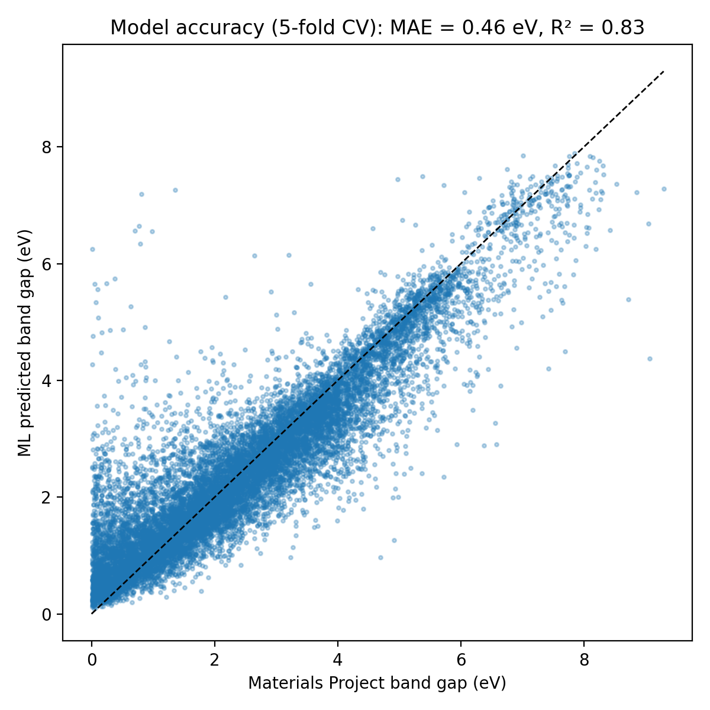
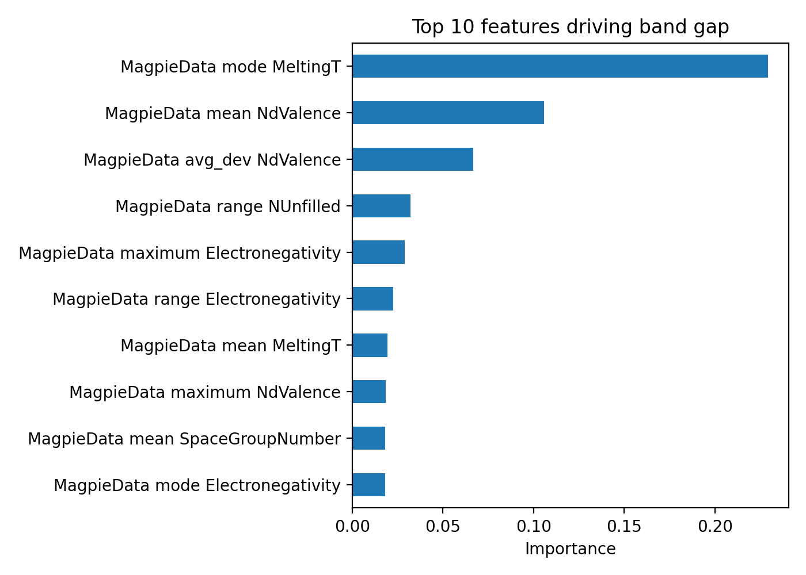
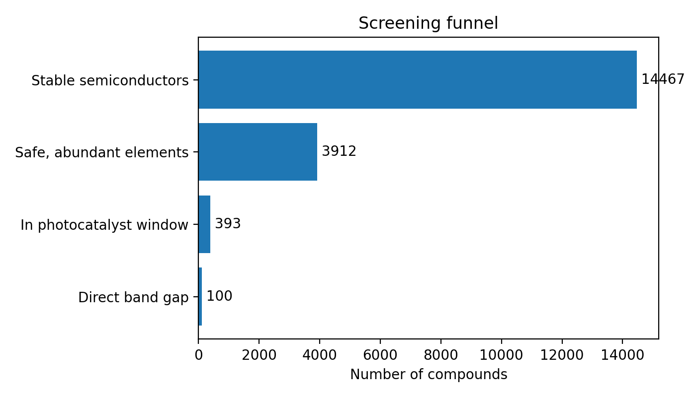
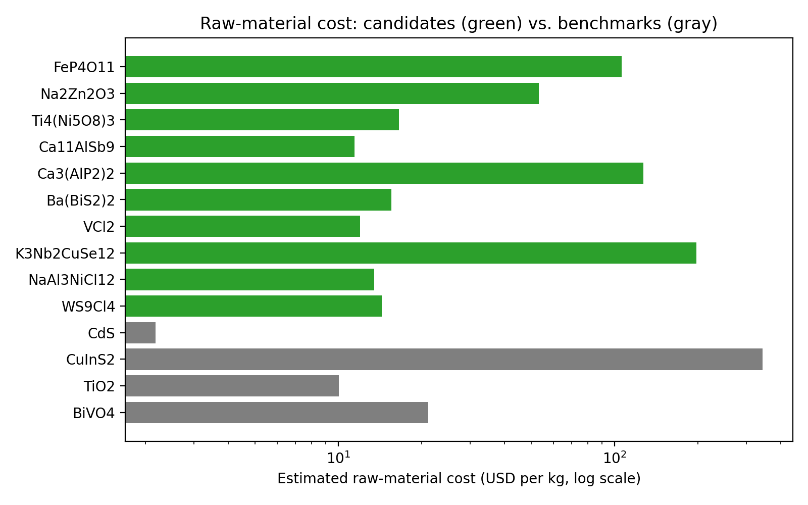

# hydrogen-photocatalyst-screening
Machine learning screen of 15,000 Materials Project compounds for non-toxic, earth-abundant photocatalysts in order to make clean hydrogen from sunlight and water

# Screening Earth-Abundant Photocatalysts for Clean Hydrogen with Machine Learning

**Testable Question:** Can machine learning help find stable materials, made only of
abundant, non-toxic elements, with the right band gap to split water into
hydrogen using sunlight? And could they be cheap enough to matter?

## Importance of Question
Oil refineries are among the largest users of hydrogen, mostly to remove
sulfur from fuels. Today most hydrogen is made from natural gas, which
releases CO2. Splitting water with sunlight and a photocatalyst could make the
same hydrogen without those emissions. Many studied photocatalysts rely on
toxic or scarce elements, so abundant, safe alternatives are valuable.

## Data Sources
- Source: Materials Project (materialsproject.org), accessed [8/24]
- [14467] stable compounds with 2 to 4 elements and a nonzero band gap 
- Features: 132 Magpie elemental descriptors generated with matminer

## Method
1. Trained a random forest to predict band gap from composition alone
2. Tested it with 5-fold cross-validation (every prediction is on unseen data)
3. Removed compounds containing toxic, scarce, rare-earth, or radioactive elements
4. Kept compounds in a 1.0 to 1.5 eV window (see note below)
5. Ranked candidates by distance from 1.25 eV
6. Estimated raw-material cost of the top 10 candidates and compared them
   with benchmark materials

**Note:** Water splitting needs at least 1.23 eV in theory, but
real losses push the practical range for a single photocatalyst to about 1.6
to 2.4 eV. Materials Project band gaps are calculated with PBE, which
underestimates real gaps by about 1.6x on average, so that range corresponds
to about 1.0 to 1.5 eV in PBE values.

## Results

### Model accuracy

- Mean absolute error: [0.46] eV (baseline of always guessing the average: [1.34] eV)  
- R²: [0.83]   
- Most important features: [MagpieData mode MeltingT ,MagpieData mean NdValence, MagpieData avg_dev NdValence  ]   <!-- Cell 8 -->

[Big electronegativity differences result in more ionic bonds. This means there will usually be bigger band gaps]

### Screening

- [3912] compounds → [486] safe and abundant → [393] in window   <!-- Cells 9 and 10 -->
- The ML model alone recovered [41]% of the final candidates   <!-- Cell 10 -->

**Top candidates:** (full list in shortlist.csv)   <!-- Cell 10 / shortlist.csv -->
| Formula | MP band gap (eV) | ML predicted (eV) | Direct gap |
|---|---|---|---|
| [FeP4O11 ] | [1.2488 ] | [ 2.360995] | [F] |
| [ Na2Zn2O3] | [ 1.2488] | [ 1.797925] | [F] |
| [Ti4(Ni5O8)3 ] | [1.2513 ] | [1.438988 ] | [F] |

[Known photocatalysts: (Cu2O, TiO2, WO3,)
appeared, whether the TiO2 control fell outside the window,because the model is built to restrict the window

## Economic analysis

### Material cost

- Median estimated raw-material cost of the top 10 candidates: $[56.783]/kg   
- Benchmarks: CuInS2 (scarce indium) $[343.30]/kg, BiVO4 $[21.11]/kg, TiO2 $[10.05]/kg,
  CdS (toxic) $[2.18]/kg   
- [Cds,BuVO4, and TiO2 are the best options that maximize gap per cost, while CuInS2 is very expensive]

### Can it compete with natural-gas hydrogen?
According to the IEA's Global Hydrogen Review 2025, hydrogen from natural gas
cost roughly $0.8 to $4.6 per kg in 2024, while hydrogen made with renewable
electricity cost about $4 to $10 or more. Depending on location, renewable
hydrogen is 1.5 to 7 times more expensive. Refining is one of the largest
markets for hydrogen, so closing this gap matters.

[I expected material cost to be the main obstacle, but my candidates came in at a median of $[56.783]/kg, cheaper than several photocatalysts researchers already study. The real cost driver is how efficiently a material turns sunlight into hydrogen, because that sets how much land and equipment every kilogram requires. For refineries to switch from natural gas, the next breakthrough has to be efficiency, not cheaper ingredients.]

## Limitations
- Band gap is necessary but not sufficient. A real photocatalyst also needs its
  band edges aligned with the water reactions, which this dataset doesn't include
- It must also survive in water without corroding
- PBE band gaps are approximate; the 1.6x correction is an average, not exact
- The model sees composition only, not crystal structure
- Element prices in the cost database are from 2013 and cover raw elements
  only, not processing or manufacturing
- My element exclusion list is a judgment call (see notebook Cell 9)

## What I learned
[Chemistry shows up in the data. The model “discovered” that electronegativity drives band gap, which matched what I learned in AP Chem about ionic bonding. Next,
A model is only useful compared to something. The baseline (always guessing the average) showed how much the model actually added. Also, cheap isn’t the same as viable. My candidates’ raw materials were cheap, but hydrogen cost depends far more on efficiency and equipment. Lastly,I want to continue to check band edge positions for my top candidates, or compare them against published experimental results.]

## Tools
Python, mp-api, pymatgen, matminer, scikit-learn, pandas, matplotlib, Google Colab

## Sources
- Materials Project: A. Jain et al., APL Materials 1, 011002 (2013)
- IEA (2025), Global Hydrogen Review 2025: https://www.iea.org/reports/global-hydrogen-review-2025
- Materials Project band gap methodology: https://docs.materialsproject.org/methodology/materials-methodology/electronic-structure
